

# Asperito

### Compose. Learn. Capture.

**A photography composition camera for iPhone.**

18 live guides · Offline lessons · Your images, without grid lines

[Explore the immersive website](https://prabhuvikas.github.io/Asperito/) · [Browse screenshots](docs/index.html#screens) · [Read the setup guide](#development)

> **Preview note:** These are authentic iPhone Simulator screenshots of the SwiftUI interface. For camera and overlay screens, the image under the guides is a **synthetic simulator scene**, not a photo captured with an iPhone. Test real-device photography before release.

## The experience

| Compose | Discover | Learn |
|:--:|:--:|:--:|
| 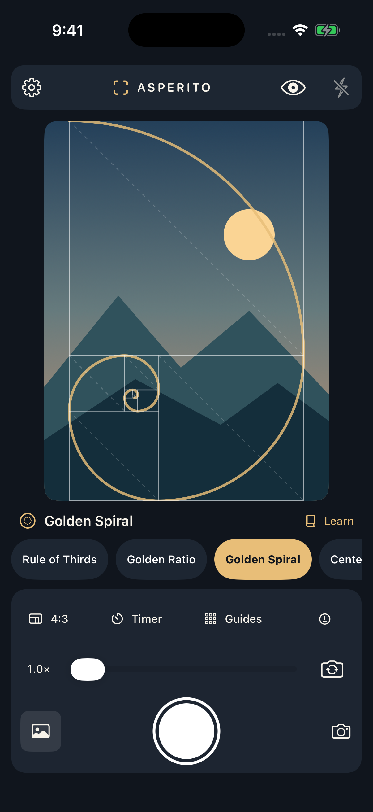 |  | 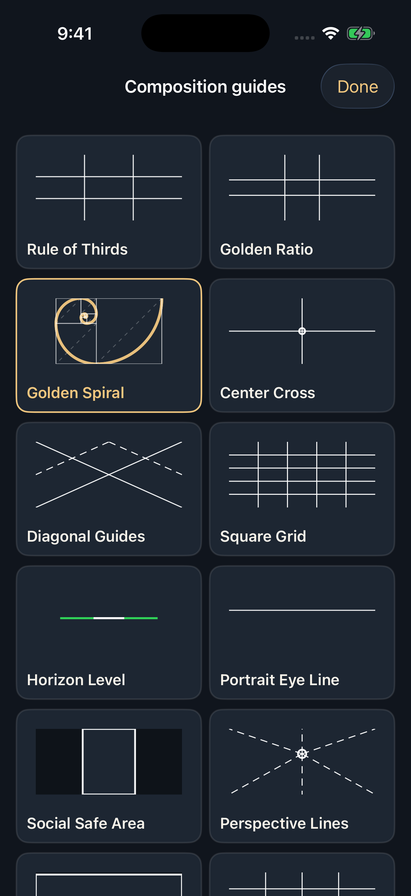 |
| Frame with live guides | Explore 18 perspectives | Learn techniques offline |

## 18 composition guides

| | | |
|:--:|:--:|:--:|
|  | 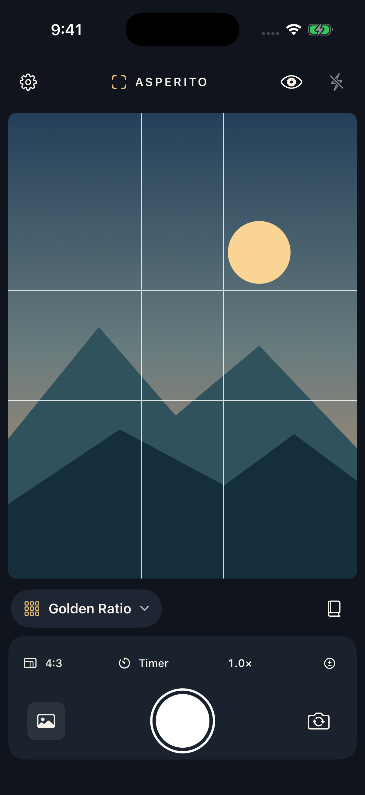 |  |
| Rule of Thirds | Golden Ratio | Golden Spiral |
| 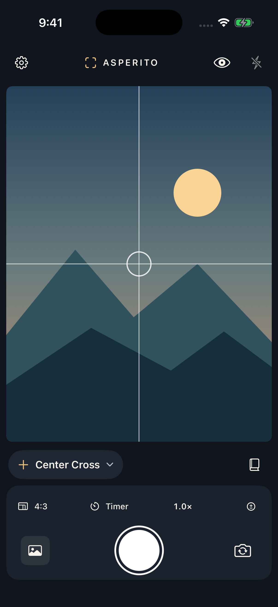 |  |  |
| Center Cross | Diagonal Guides | Square Grid |
|  | 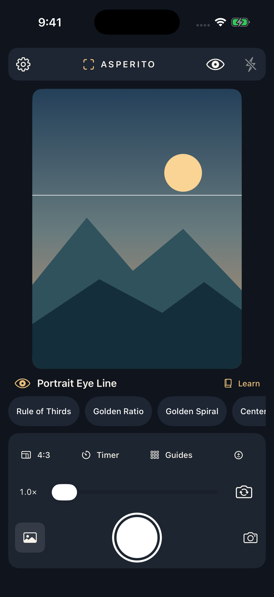 | 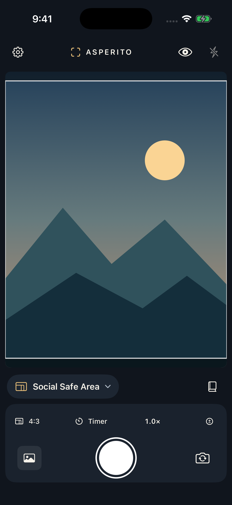 |
| Horizon Level | Portrait Eye Line | Social Safe Area |
| 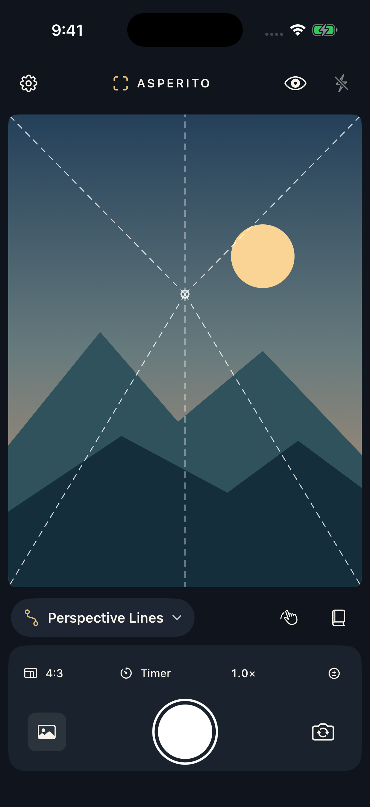 | 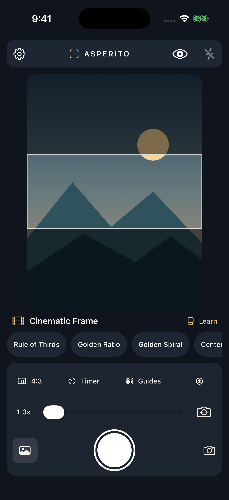 | 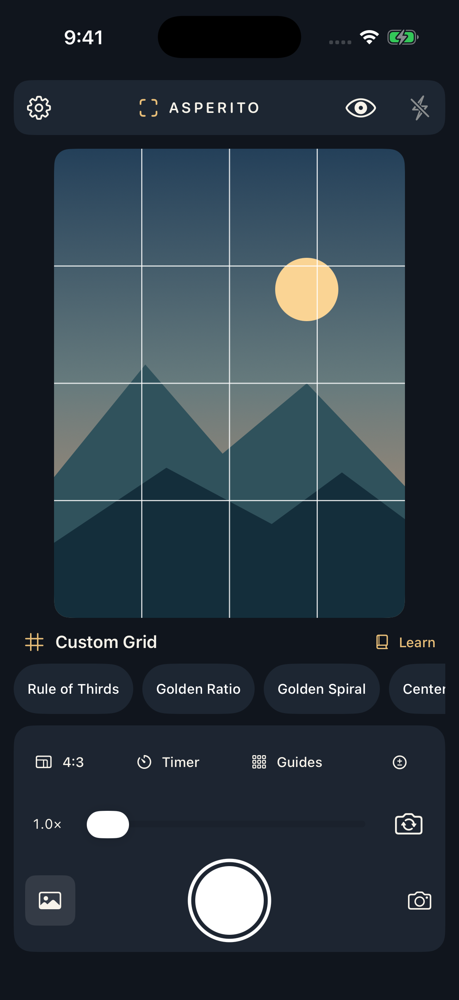 |
| Perspective Lines | Cinematic Frame | Custom Grid |
|  |  | 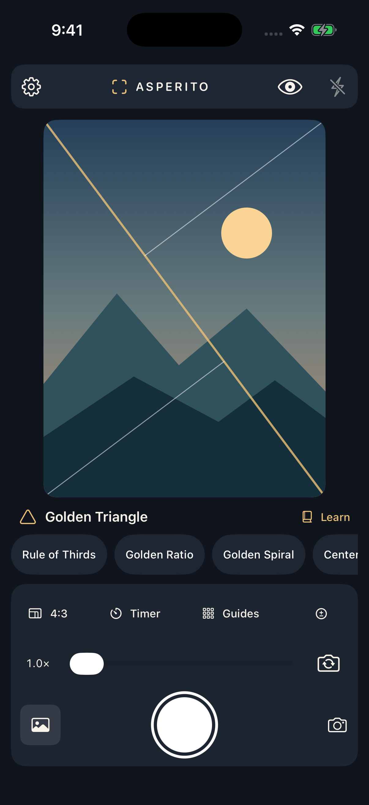 |
| Leading Lines | Symmetry & Reflection | Golden Triangle |
|  |  | 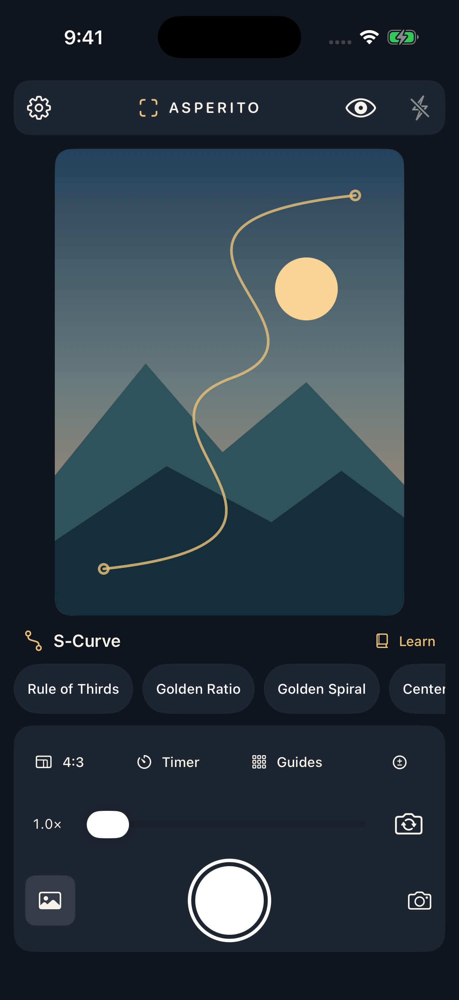 |
| Frame Within Frame | Negative Space | S-Curve |

[Open the complete screenshot gallery](https://prabhuvikas.github.io/Asperito/#screens)

## Camera essentials

- Native SwiftUI camera with AVFoundation.
- Front/rear camera, zoom, tap-to-focus, exposure, and flash on supported devices.
- Optional shutter timer and 4:3, square, and 16:9 framing.
- Gold / white / cyan / red composition-guide colors and opacity.
- Golden Spiral rotate/mirror, custom grid rows/columns, horizon guide.
- Leading Lines, Symmetry & Reflection, Golden Triangle, Frame Within Frame, Negative Space and S-Curve, with editable positioning, size, rotation or mirroring as appropriate.
- Photo saving into Photos **without guide overlays baked into pixels**.
- No login, backend, cloud sync, tracking, or internet required for core app functionality.

## App screens

| Onboarding | Camera | Settings |
|:--:|:--:|:--:|
| 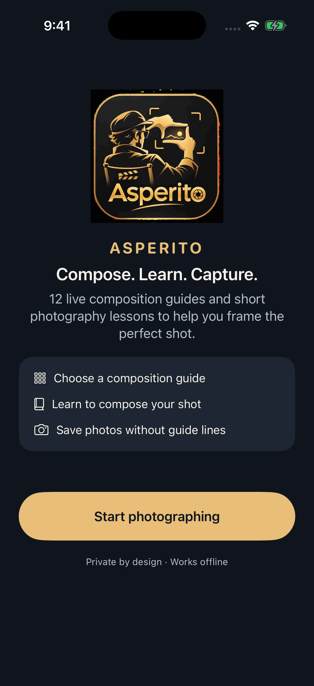 | 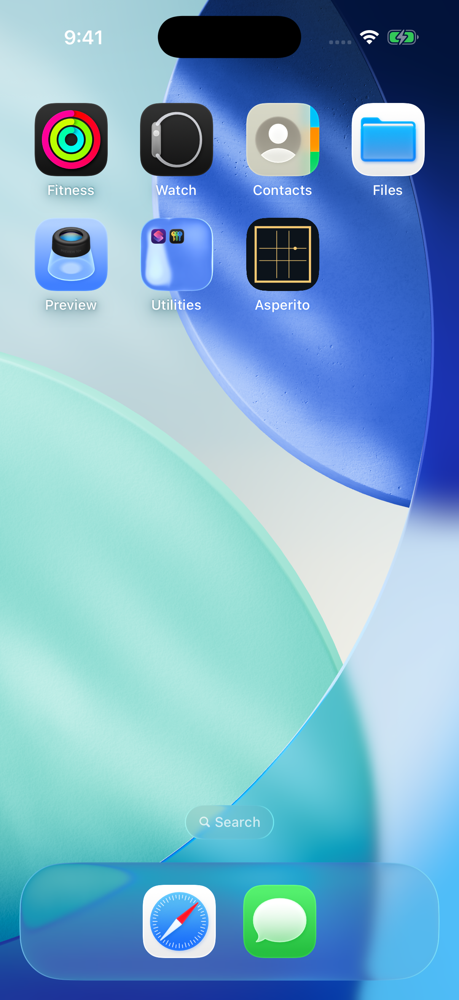 | 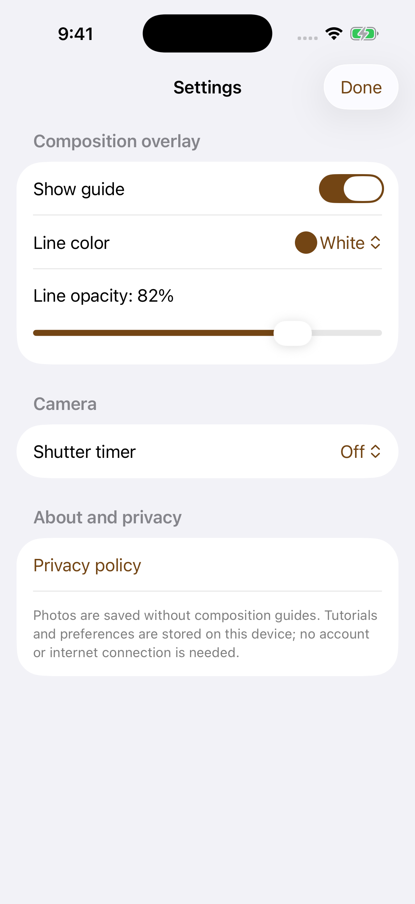 |

## Development

**Public app name:** Asperito  
**Internal Xcode project and target:** FrameGuide (public repository: Asperito)  
**Minimum iOS:** 17.0

1. Open `FrameGuide.xcodeproj` using Xcode on macOS, or use the GitHub Actions simulator build to validate without a Mac.
2. Configure your Apple signing team and a unique bundle identifier for on-device installation.
3. Run on an actual iPhone; the simulator cannot exercise real camera hardware.
4. Grant Camera permission, then allow Add Photos when saving a photograph.
5. Check [the App Review readiness audit](APP_REVIEW_READINESS.md), [PR automation](PR_AUTOMATION.md), [screenshot capture documentation](SCREENSHOT_CAPTURE.md), and [privacy policy](PRIVACY.md).

GitHub Actions captures 23 UI screenshots with `simctl` and makes them available as downloadable artifacts. The website publication workflow copies validated screenshots into `docs/screenshots/` for stable, inspectable links.

## Quality assurance

The simulator CI suite now includes unit tests, a separate XCUITest integration target, a focused source coverage gate, 23-screen screenshots, and desktop/mobile browser checks for all 18 composition guides. See the [full release acceptance matrix](RELEASE_TEST_PLAN.md) for the **mandatory physical iPhone tests** that cannot be validated in Simulator.

## TestFlight status

The iOS Simulator build and unit tests have passed. A signed TestFlight release still requires Apple Developer enrollment, real-device hardware/Photos testing, and final App Store Connect metadata. The screenshots on this page are **not** proof of camera quality or hardware testing.

## Privacy

Photos remain on your device. The app does not upload images or collect analytics. [Read the privacy policy](PRIVACY.md).

---

Asperito · An independent camera experience, built with native Apple frameworks. Website design is Apple-inspired, not affiliated with Apple Inc.

